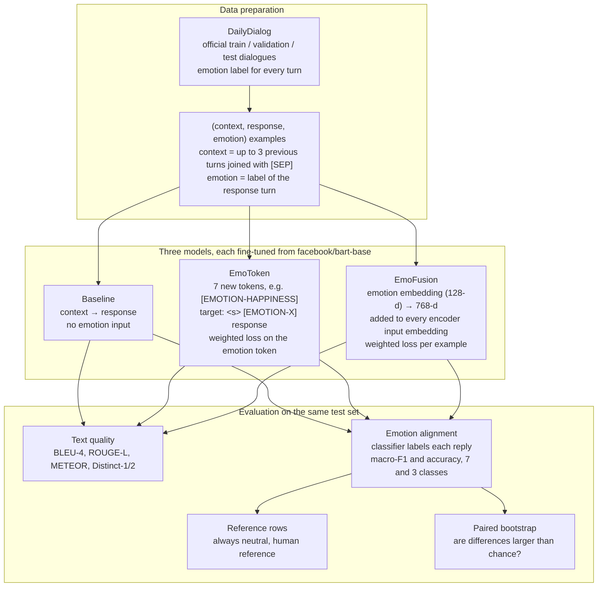

# Design notes

## Question

If a dialogue model is told which emotion its reply should have, does it follow it, and where should that information enter the model: on the decoder side as a token, or on the encoder side as an embedding?

## Architecture

## How emotion is given to each model

| Model | Training | Generation |
|---|---|---|
| Baseline | Context → response | Context only |
| EmoToken | Target is `<s> [EMOTION-X] response </s>`, so after BART's shift-right the decoder sees `</s> <s> [EMOTION-X] …` | Decoder starts from the prompt `</s> <s> [EMOTION-X]`, the same layout as in training |
| EmoFusion | A learned emotion vector is added to every token embedding of the encoder input | The same vector is added before generation |

The emotion models are given the reference response's true emotion at test time (the **oracle setting**). This tests whether a model can follow an emotion it is given. It does not test whether it can choose the right emotion, which a real system would need as a separate step: an angry user usually needs a calm reply, not an angry one.

## Design choices

**Official dialogue-level split.** DailyDialog's authors split the dialogues into train, validation and test. Using that split keeps each conversation in one split, so no test conversation, or part of one, is seen in training. Shuffling individual (context, response) pairs instead would put turns of the same conversation in both training and test.

**One data pipeline for all models.** The same examples, tokenization limits and test set are used for all three models, so the comparison is like-for-like.

**Matching EmoToken's training and generation.** Generation starts from exactly the decoder sequence the model saw in training. An extra row, *EmoToken (no `<s>` in prompt)*, generates from `</s> [EMOTION-X]` instead, to measure how much this matters.

**Class weighting.** About 80% of responses are neutral. Each emotion gets a weight equal to the square root of its inverse frequency, scaled so the average weight over training examples is 1.
- The square root keeps the weighting moderate. With plain inverse frequency, a neutral example would count roughly 50 times less than a rare one, and the model would effectively learn from a small part of the data.
- EmoToken applies the weight to the loss on the emotion token. EmoFusion multiplies each example's loss by its own weight.
- Weighting per example avoids a problem with weighting per batch: an all-neutral batch would barely update the model.
- Validation loss is unweighted, so all three models' validation losses are on the same scale.

**Macro-F1 as the main metric.** With most responses neutral, a model that only produces neutral replies gets high accuracy. Macro-F1 averages over emotions, so rare emotions count equally. Two reference rows make the numbers easier to read:
- *Always neutral*: the score if every reply is labelled neutral.
- *Human reference*: the real replies scored by the same classifier, showing how often the classifier agrees with DailyDialog's labels. This is a practical ceiling for the metric.

**Paired bootstrap.** Differences between models are checked by resampling the test set 1,000 times. If the 95% interval of a difference includes 0, it is not reported as a real difference.

**Resumable training.** Each model saves a resume file after every epoch, so a Colab disconnect costs at most one epoch.

## Training setup

- `facebook/bart-base`, full fine-tuning, starting from the same pretrained weights for every model
- 3 epochs, AdamW (lr 3e-5, weight decay 0.01), 200 warmup steps with linear decay
- Batch 16 with 2-step gradient accumulation (effective 32), gradient clipping at 1.0
- Mixed precision (fp16) on the GPU, dynamic padding
- Inputs up to 128 tokens, responses up to 64 tokens
- Best epoch chosen by validation loss
- Seed 42

## Results

*To be added after running the notebook.*

## Limitations

1. **Oracle emotion.** The emotion models receive the correct target emotion, which a deployed system would not know.
2. **Classifier as judge.** Emotion alignment depends on an external classifier trained on different data, and its emotion categories do not match DailyDialog's exactly. The human reference row shows how far it agrees with DailyDialog's labels.
3. **Single seed.** One training run per model. The bootstrap captures variation from the test set, not from training randomness.
4. **Automatic metrics only.** BLEU and ROUGE measure overlap with one reference reply, which is a weak measure for open-ended dialogue. Human evaluation would be more reliable.
5. **DailyDialog's labels are imbalanced** and some dialogues appear more than once in the dataset.

## Next steps

- A non-oracle setting: predict the reply's emotion from the context, then condition on the prediction.
- Two or three seeds per model.
- A small human evaluation of emotional appropriateness and fluency.
- Compare with prompting an instruction-tuned LLM to reply with a given emotion.
