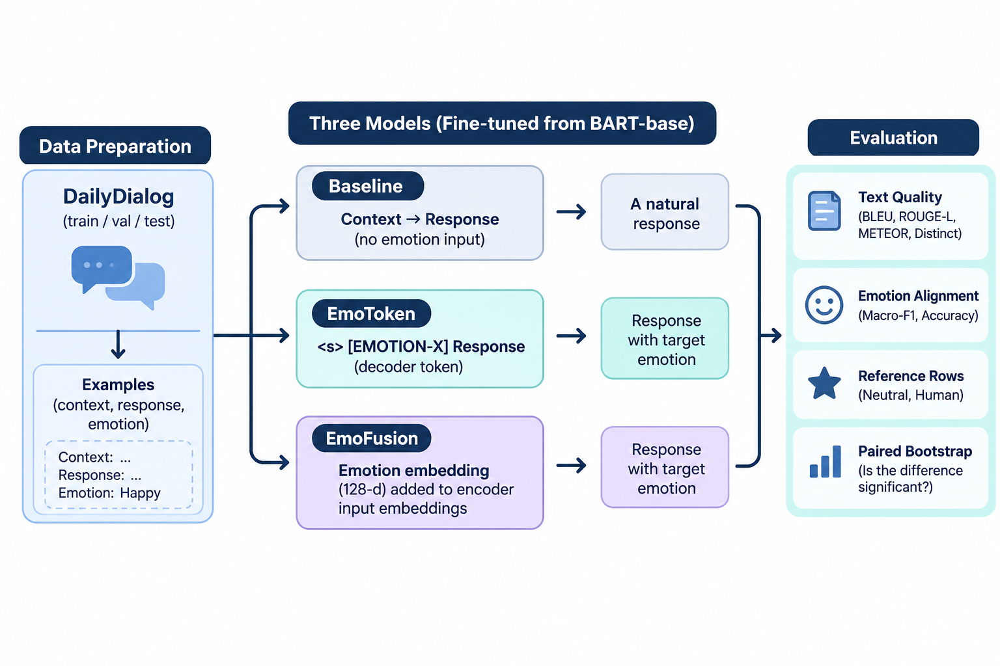

# Emotion-Conditioned Dialogue Generation with BART

Dialogue models usually produce replies that make sense in context but ignore emotion. This project fine-tunes BART on DailyDialog and compares two ways of telling the model which emotion its reply should have:

- **EmoToken:** an emotion token such as `[EMOTION-HAPPINESS]` starts the decoder output.
- **EmoFusion:** a learned emotion vector is added to every encoder input embedding.

Both are compared with a **baseline** that gets no emotion information. All three are trained from the same pretrained weights, on the same data, and evaluated on the same test set.



For the architecture, design choices and limitations, see [DESIGN.md](DESIGN.md).

The project started as a course project and was rebuilt from scratch with a corrected evaluation.

## Results

All models are evaluated on the same 6,740 test examples (the official DailyDialog test dialogues). Emotion macro-F1 is the main metric; accuracy is shown for completeness, but it is dominated by the neutral class (see _Always neutral_).

| Model                                  | BLEU-4   | ROUGE-L   | METEOR    | Distinct-2 | Emotion macro-F1 (7) | Emotion macro-F1 (3) | Emotion acc (7) |
| -------------------------------------- | -------- | --------- | --------- | ---------- | -------------------- | -------------------- | --------------- |
| Baseline                               | 2.73     | 15.89     | 15.39     | 18.66      | 18.60                | 38.66                | 54.69           |
| **EmoToken**                           | **3.05** | **16.57** | **16.20** | 19.11      | 27.95                | 47.54                | 63.18           |
| **EmoFusion**                          | 1.85     | 15.24     | 14.21     | **19.42**  | **28.44**            | **50.17**            | 65.16           |
| EmoToken, mismatched prompt (ablation) | 2.77     | 15.85     | 15.37     | 18.89      | 19.23                | 38.90                | 52.92           |
| _Human reference_                      | –        | –         | –         | –          | _28.38_              | _49.02_              | _63.74_         |
| _Always neutral_                       | –        | –         | –         | –          | _12.78_              | _29.82_              | _80.92_         |

Paired bootstrap on 7-class emotion macro-F1 (1,000 resamples):

| Comparison                                         | Difference (pts) | 95% CI        |
| -------------------------------------------------- | ---------------- | ------------- |
| EmoToken vs Baseline                               | +9.33            | 7.72 to 11.05 |
| EmoFusion vs Baseline                              | +9.82            | 7.88 to 11.60 |
| EmoFusion vs EmoToken                              | +0.49            | −1.28 to 2.22 |
| EmoToken vs EmoToken, mismatched prompt (ablation) | +8.69            | 7.42 to 10.19 |

**Findings**

1. Both emotion models improve emotion macro-F1 by about 9–10 points over the baseline, and the bootstrap intervals exclude zero.
2. EmoToken and EmoFusion are not significantly different at following the target emotion.
3. EmoToken has the highest BLEU-4, ROUGE-L and METEOR. EmoFusion has the lowest overlap with the reference replies and the highest Distinct-2.
4. Both emotion models reach the macro-F1 of the human reference (the real replies scored by the same classifier), which is the practical ceiling of this metric.
5. Ablation: generating EmoToken without the `<s>` token used in training reduces its macro-F1 to the baseline's level.
6. Labelling every reply neutral gives 80.9% accuracy but 12.8 macro-F1, so macro-F1 is used as the main metric.

Absolute BLEU and ROUGE scores are low, as is typical for open-ended dialogue, where many replies are valid but each is compared with a single reference. These results come from one training run per model, with the target emotion given to the emotion models (see DESIGN.md).

## How to run

Everything is in one notebook, [`EmoCon.ipynb`](EmoCon.ipynb). It needs no files from you: it downloads DailyDialog, trains the three models, and evaluates them.

1. Open `EmoCon.ipynb` in Google Colab (upload it, or open it from GitHub).
2. Choose Runtime → Change runtime type → **T4 GPU**.
3. Choose Runtime → **Run all**, and allow access to Google Drive when asked.

Everything is saved to `MyDrive/EmoCon/`:

```
MyDrive/EmoCon/
├── config.json             settings used for the run
├── data/                   the downloaded dataset and the prepared examples
├── checkpoints/            baseline/, emotoken/, emofusion/
└── outputs/                generated responses, results.md, results.csv, bootstrap.csv
```

**If Colab disconnects:** open the notebook again and choose Run all. Finished models are skipped, an unfinished model resumes from its last completed epoch, and saved outputs are reused. Training three models takes several hours in total, so expect to do this at least once on the free tier. Each epoch's time is printed, so after the first epoch you can estimate the rest.

**If the dataset download fails:** download `ijcnlp_dailydialog.zip` from http://yanran.li/dailydialog, put it in `MyDrive/EmoCon/data/`, and run the notebook again. The notebook also tries a copy on the Hugging Face Hub before asking for this.

## Setup

|                    |                                                                                                   |
| ------------------ | ------------------------------------------------------------------------------------------------- |
| Model              | `facebook/bart-base` (139M parameters), full fine-tuning                                          |
| Data               | DailyDialog, official train / validation / test split (11,118 / 1,000 / 1,000 dialogues)          |
| Examples           | Context of up to 3 previous turns; target emotion = the response turn's label                     |
| Training           | 3 epochs, AdamW (lr 3e-5), effective batch 32, mixed precision, best epoch by validation loss     |
| Class imbalance    | Square-root inverse-frequency weights: on the emotion token (EmoToken) or per example (EmoFusion) |
| Generation         | Beam search, 4 beams, no repeated 3-grams                                                         |
| Emotion classifier | `j-hartmann/emotion-english-distilroberta-base`                                                   |
| Main metric        | Emotion macro-F1, with a paired bootstrap for significance                                        |
| Hardware           | Google Colab, T4 GPU                                                                              |

## Repository

```
├── EmoCon.ipynb       the whole project: data, training, generation, evaluation
├── README.md
├── DESIGN.md          architecture, design choices, limitations, next steps
└── requirements.txt   for running outside Colab
```
